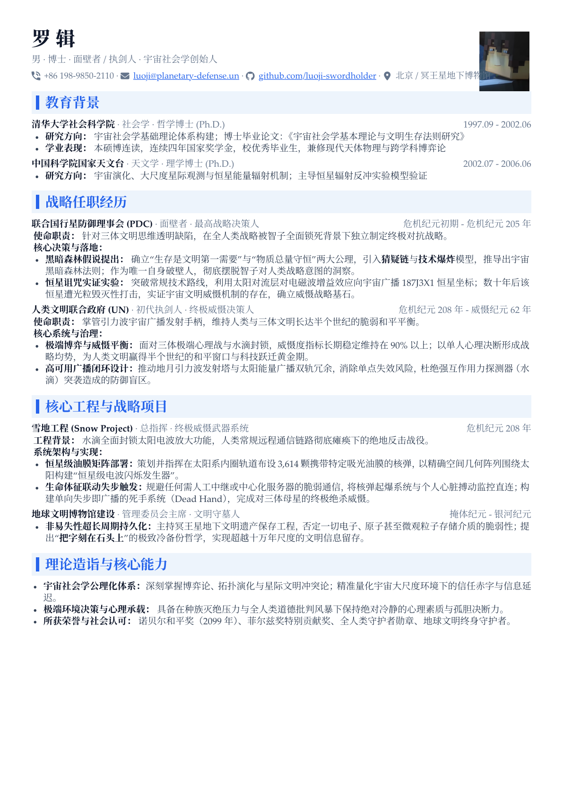

# Modern Typst Resume (单页工程师简历模板)

专为技术研发人员（后端、全栈、算法、Agent / AI 应用开发）设计的高信息密度、现代化、抗视觉疲劳的 Typst 单页简历模板。

> [!NOTE] 致谢与开源参考
> 本项目参考并衍生自开源项目 [habaneraa/typst-resume-one-page](https://github.com/habaneraa/typst-resume-one-page)，在此对原作者表示诚挚感谢！本项目在此基础上针对现代技术岗位需求，进一步重构了微徽章标题横幅、三级防疲劳灰度色彩、动态紧凑度因子（`element-spaciness`）及中英文（思源宋体 + Palatino）优雅混排机制。

---

## 效果预览



---

## 核心设计特性

- **现代微徽章标题设计**：小节标题采用左侧垂直色块（Accent Bar）搭配全宽浅色横幅填充，替代传统生硬的横线或大黑框，层次清晰且视觉通透。
- **三级防疲劳灰度色彩系统**：
  - 一级标题 / 姓名 / 重点：深石板黑 (`#0F172A`)，告别纯黑（`#000000`）带来的刺眼疲劳感。
  - 正文内容：柔和深灰 (`#334155`)，保持高阅读辨识度。
  - 次级元信息（时间、副标题、联系方式）：中灰 (`#64748B`)，主次分明。
- **单页严丝合缝控制（Dynamic Spacing）**：提供 `element-spaciness` 全局间距缩放系数，无需繁琐调整各个容器 margin，微调参数（如 `0.95 ~ 1.05`）即可让内容严丝合缝卡在单页 A4 纸内。
- **现代化图标支持**：内置 `@preview/nerd-icons:0.2.0` 图标库，电话、邮箱、GitHub、主页等联系方式自动排版。
- **开箱即用（三体 · 罗辑示例）**：内置《三体》面壁者/执剑人罗辑的经典简历示例，极客趣味与硬核结构兼备，生动展示单页高信息密度的排版效果。

---

## 项目结构

```text
resume-template/
├── resume-template.typ    # 核心模板函数库 (setup-styles, resume-header, resume-entry)
├── examples/
│   ├── resume-zh.typ      # 单页中文示例（三体 · 罗辑）
│   ├── luoji.typ          # 同步示例镜像
│   └── resume-zh.pdf      # 编译产物 PDF
├── assets/
│   ├── avatar.png         # 罗辑头像占位图
│   └── preview.png        # 效果预览图
├── fonts/                 # 本地备用 Nerd Font 符号字体
├── LICENSE                # MIT 开源协议
└── README.md              # 说明文档
```

---

## 快速开始

### 推荐方式：VS Code + Tinymist 插件（所见即所得）

使用 VS Code 搭配官方社区主流插件 **Tinymist** 是体验最佳的 Typst 编辑工作流：

1. **安装插件**：在 VS Code 插件市场搜索并安装 `Tinymist Typst`（插件 ID: `myriad-dreamit.tinymist`）。
2. **克隆项目并且打开**：首先先clone该项目，在 VS Code 中打开本仓库根目录。
```bash
git clone https://github.com/ver0810/typst-resume-template.git

cd typst-resume-template/
```
3. **实时预览与导出**：
   - 打开 `examples/resume-zh.typ` 文件；
   - 点击编辑器右上角的「打开预览」图标（或使用快捷键 `Ctrl+K V` / `Cmd+K V`），即可在右侧开启毫秒级热重载预览窗口；
   - 在预览窗口右上角点击导出按钮，或使用命令面板（`Ctrl+Shift+P`）输入 `Tinymist: Export Current Document as PDF` 即可导出 PDF。

---

### 备用方式：CLI 命令行

适合终端爱好者或自动化 CI/CD 流水线：

#### 1. 安装 Typst CLI

- **macOS (Homebrew)**: `brew install typst`
- **Windows (Winget)**: `winget install --id Typst.Typst`
- **Linux / Arch**: `pacman -S typst` 或从 [GitHub Releases](https://github.com/typst/typst/releases) 下载二进制放入系统 PATH。

#### 2. 实时监听开发

```bash
typst watch --root . --font-path ./fonts examples/resume-zh.typ
```

#### 3. 导出编译为 PDF

```bash
typst compile --root . --font-path ./fonts examples/resume-zh.typ examples/resume-zh.pdf
```


## 优雅的中英文字体混排

模板原生采用“**西文字体在前，中文字体在后**”的声明机制：
- **英文字符与阿拉伯数字**：优先由优雅经典的衬线体 **Palatino**（`Palatino Linotype` / `Palatino`）渲染；
- **中文字符**：Palatino 缺字时自动优雅回退至权威的开源衬线体 **思源宋体**（`Source Han Serif SC` / `Noto Serif SC`）。

```typst
#let (resume-header, resume-entry) = setup-styles(
  font-family: ("Palatino Linotype", "Palatino", "Source Han Serif SC", "Noto Serif SC"),
  // ... 其他配置
)
```

本地编译时推荐携带 `--font-path ./fonts` 参数以确保字体加载完整。

---

## 单页排版控行技巧

在技术简历中，**严格卡在单页（不多 1 行也不空留大面积空白）** 是专业度的体现：

1. **利用 `element-spaciness` 缩放**：
   - 若出现文字溢出到第 2 页第一行：将 `element-spaciness` 设为 `0.96` 或 `0.94`；
   - 若页面底部留白过多：将 `element-spaciness` 设为 `1.04` 或 `1.06`。
2. **字号微调**：
   - 默认基准字号为 `9.8pt ~ 10pt`，必要时可在 `9.5pt` 至 `10.2pt` 之间微调。
3. **行距与段距自动自适应**：
   - 内部已将 `par(leading: ...)` 与 `par(spacing: ...)` 绑定至 `element-spaciness`，全局间距协同缩放，避免局部挤压变形。

---

## 开源协议

本项目基于 [MIT 许可证](LICENSE) 开源。欢迎 Star、Fork 与二次定制！
